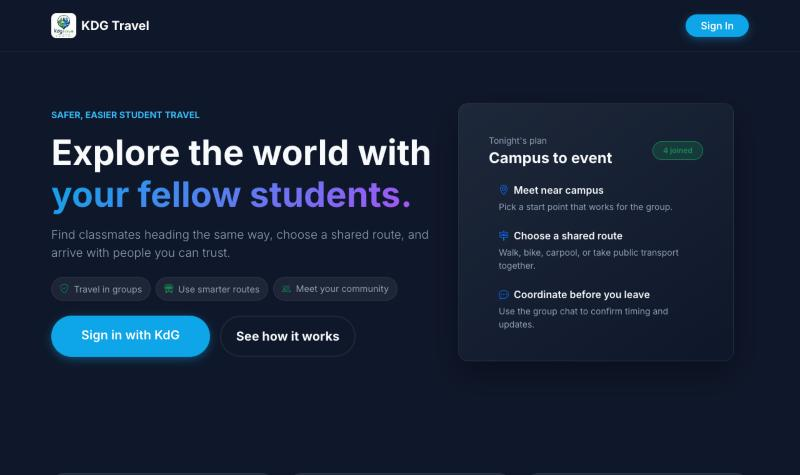
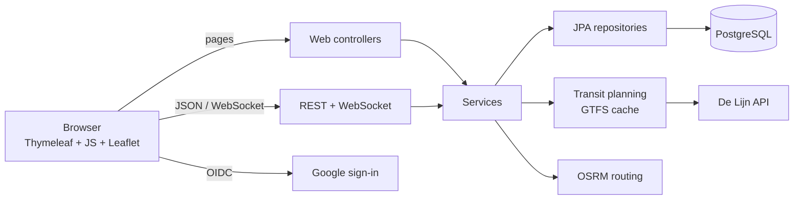

# KdG Travel: travel together to events

A Spring Boot web application that helps students travel together to events. Users discover activities, form travel groups, plan a shared route (walking, cycling or public transport), share their live location with the group, and get notified when friends join the same plans.



## Features

- **Activities and travel groups:** create, discover and join events, then form travel groups per activity with a transport mode and route.
- **Public-transport routing:** suggested De Lijn routes from GTFS static data with realtime updates, saved per group as a route snapshot. See [docs/route-suggestion-system.md](docs/route-suggestion-system.md).
- **Walking and cycling routes** through OSRM, shown on a Leaflet map.
- **Live location radar:** group members opt in to share GPS, and everyone on the group page sees each other on the route map, updated by polling a REST endpoint.
- **Group chat** on the travel group page over WebSocket (STOMP + SockJS).
- **Friends and social graph:** friend requests, accept/decline, block, and a "frequent travel buddies" list on the profile page.
- **Suggestions and invites:** invite friends to an activity with one click, and get buddy-match notifications when a friend joins an activity you're on.
- **Notifications:** bell dropdown with deep links to activities, groups and profiles.
- **Admin dashboard:** verification, reports, user moderation and analytics, with role-based permissions (student, moderator, admin, super admin).
- **Sign-in with Google (OIDC).**

## Tech stack

| Area | Technologies |
|---|---|
| Backend | Java 21, Spring Boot 4 (Web MVC, Data JPA, Security, OAuth2 client, WebSocket), Lombok |
| Frontend | Thymeleaf, Bootstrap 5, JavaScript, Leaflet |
| Data | PostgreSQL, Hibernate |
| Integrations | De Lijn API (GTFS static and realtime), OneBusAway GTFS, OSRM |
| DevOps | Gradle, Docker, GitLab CI/CD, Google Cloud (Compute Engine, Cloud SQL), Nginx, Let's Encrypt |

## Architecture

A layered Spring Boot application. Thymeleaf page controllers and REST controllers (used by the JavaScript on the pages) call services. Services hold the business logic and use Spring Data JPA repositories. Transit routing is a separate service package that loads and caches the De Lijn GTFS feed, plans routes over it, and adds realtime departures.



**Deployment:** a GitLab CI/CD pipeline builds and tests the app, then deploys it to a Google Compute Engine VM. Two Docker containers run behind Nginx in a blue-green setup, so a new version only receives traffic after it passes a health check. The database is Cloud SQL. See [docs/deployment.md](docs/deployment.md) and the scripts in `scripts/`.

## Getting started

Prerequisites: JDK 21 and Docker.

```bash
git clone https://github.com/miqqayell/kdg-travel-spring.git
cd kdg-travel-spring

docker compose up -d          # PostgreSQL on localhost:5435
./gradlew bootRun             # dev profile, http://localhost:8080
./gradlew build               # compile and run the tests (needs the database running)
```

In the dev profile, `DataSeeder` adds a demo user and a few activities on first start.

Configuration comes from environment variables (see `.env.example`):

| Variable | Needed for |
|---|---|
| `DB_URL`, `DB_USER`, `DB_PASSWORD` | Database. The dev profile defaults to the compose database. |
| `GOOGLE_CLIENT_ID`, `GOOGLE_CLIENT_SECRET` | Signing in. Create an OAuth client in Google Cloud Console with redirect URI `http://localhost:8080/login/oauth2/code/google`. |
| `DELIJN_API_KEY`, `DELIJN_GTFS_STATIC_KEY`, `DELIJN_GTFS_REALTIME_KEY` | Public transport suggestions (free keys from the De Lijn open data portal). |

Without Google credentials the app starts and the public pages work, but you can't sign in.

## My role

Team lead in a team of five. I was responsible for planning, coordinating the team and setting the product direction.

## What I learned

- **Java and Spring Boot:** building a layered application with controllers, services, repositories, Spring Security and OAuth2/OIDC login.
- **SQL and JPA:** modelling entities and relations, and writing repository queries on PostgreSQL.
- **APIs and real-time features:** integrating external APIs (De Lijn, GTFS, OSRM) and building a group chat over WebSocket.
- **DevOps:** CI/CD pipelines, Docker, cloud deployment on Google Cloud and zero-downtime blue-green releases.
- **Leading a team:** planning work, dividing tasks across five people and keeping a large codebase consistent.

## Team

| Member | Role |
|---|---|
| Mikayel Ghalumyan | Team lead |
| Teammate 1 | Developer |
| Teammate 2 | Developer |
| Teammate 3 | Developer |
| Teammate 4 | Developer |

## Context

University project, KdG Applied Computer Science, Integration 4, 2025-2026.

Not affiliated with De Lijn. Transit data is used through De Lijn's open data API.

When preparing this repository I moved all API keys and credentials into environment variables, added `compose.yaml`, the permission unit tests and the deployment documentation. The original project used a separate infrastructure repository, which is merged here under `scripts/` and `docs/`.

## Possible improvements

- More automated tests. Most tests need a running database; Testcontainers would make them self-contained.
- A demo login for local development, so the app can be explored without creating a Google OAuth client.
- Push location updates over the existing WebSocket connection instead of polling.
